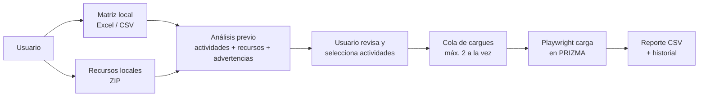

# Auto Prizma Pro — Interfaz de cargue automático

Aplicación web que automatiza el cargue de contenidos académicos en **PRIZMA**. A partir de una matriz Excel/CSV local y un ZIP de recursos, la aplicación entra a PRIZMA con un navegador automatizado y carga las actividades **OVI**, **OVA** y **Retos evaluativos (Challenge)**. También crea **tests evaluativos** desde un documento Word (.docx) local.

Construida con **FastAPI** y **Playwright (Chromium)**. Se despliega en **Railway** con Docker.

---

## Contenido

- [Funcionalidades](#funcionalidades)
- [Cómo funciona](#cómo-funciona)
- [Tecnologías](#tecnologías)
- [Estructura del proyecto](#estructura-del-proyecto)
- [Instalación local](#instalación-local)
- [Variables de entorno y credenciales](#variables-de-entorno-y-credenciales)
- [Administración de usuarios](#administración-de-usuarios)
- [Uso: cargue de actividades](#uso-cargue-de-actividades)
- [Uso: tests evaluativos](#uso-tests-evaluativos)
- [Datos y persistencia](#datos-y-persistencia)
- [Seguridad](#seguridad)
- [Despliegue en Railway](#despliegue-en-railway)
- [Pruebas](#pruebas)
- [Notas para mantenimiento](#notas-para-mantenimiento)
- [Solución de problemas](#solución-de-problemas)

---

## Funcionalidades

- **Acceso local directo.** En el mismo equipo no se solicita cuenta de Auto Prizma; los despliegues remotos conservan cuentas y aislamiento por usuario.
- **Entrada solo por archivos.** La matriz se sube como Excel/CSV, los recursos como ZIP y los tests como Word (.docx). No hay conexión ni descarga desde cuentas externas.
- **Análisis previo.** Antes de cargar nada, muestra las actividades reconocidas y revisa los recursos incluidos en el ZIP.
- **Selección de actividades.** El usuario elige qué actividades cargar después de revisar el análisis.
- **Cola de cargues.** Hasta **2 cargues simultáneos**; los demás esperan en cola y se muestra su posición.
- **Seguimiento en vivo.** Página de progreso por cargue, con opción de cancelar.
- **Historial y reportes separados por flujo.** PRIZMA conserva sus reportes CSV; Moodle ofrece una pestaña independiente con reportes CSV/JSON de sus publicaciones.
- **Tests evaluativos.** Lee un .docx con preguntas, lo valida, permite corregirlo en pantalla y lo crea en PRIZMA. Puede hacerse por separado (`/tests`) o junto con un cargue de actividades.
- **Cargue Moodle local.** En `/moodle` analiza una matriz CSV/XLSX y un ZIP de PDF/H5P, muestra la vista previa por semana y publica en un curso Prizma con Chromium visible e inicio de sesión manual. La pestaña **Etiquetas** contiene tarjetas separadas para banners, infografías y videos; puedes arrastrar la imagen y el HTML correspondiente se genera automáticamente, con la imagen en `src` como Data URL sin subirla a Moodle.
- **Tema claro/oscuro** y diseño adaptable a móvil.

---

## Cómo funciona

La página **Inicio** es la landing de espacios de trabajo: las tarjetas de **Matrices** (`/matrices-favoritas`), **Cargue PRIZMA** (`/prizma`),
**Cargue Moodle** (`/moodle`) y **Automatizaciones** (`/automatizaciones-n8n`) siguen el orden del sidebar. La cabecera tiene accesos directos a PRIZMA administrativo y Control Tower. La app usa transiciones y animaciones suaves en navegación y controles, se adapta al tema y respeta la preferencia de reducir movimiento.
Debajo de Inicio, el sidebar ofrece **Control Tower**, enlace a la herramienta de gestión de tareas de Google Apps Script; se abre en una pestaña nueva porque Google puede impedir que se incruste dentro de Auto Prizma. Después aparece **Matrices** (`/matrices-favoritas`),
para guardar enlaces compartidos de uso frecuente. Escribe un nombre y una URL HTTP(S)
para crear una tarjeta; desde la tarjeta puedes abrir, editar o eliminar el enlace. El catálogo
se conserva localmente en `data/matrices_favoritas.json`, no caduca y solo cambia al editarlo
o eliminarlo manualmente; lo comparten los usuarios autenticados de esta instalación.
Cargue PRIZMA abre primero en Auditor y
reúne en pestañas Auditor, Cargue, Test, Cursos, En curso, Historial y Reportes; Moodle mantiene sus pestañas
independientes de Cargue, Auditor y Reportes. Los auditores revisan **todas las filas de la matriz que tengan enlace** (incluidos Video Intro, Video Cierre y videos a cámara, que se buscan como .webm/.mp4) y señalan nombres de recurso vacíos, archivos vacíos y diferencias entre el título del paquete H5P (`h5p.json`) y el nombre del recurso de la matriz; la ausencia de una portada/título principal no genera por sí sola una alerta. También revisan lectura y coincidencia con la matriz. El cargue Moodle bloquea PDF vacío o ilegible. La sección n8n ofrece cuatro flujos y un acceso directo para **Crear semanas de curso** en PRIZMA desde CSV. Los flujos incluyen:
tests JSON, descargar recursos, generar matriz CSV y crear plantillas temáticas.
Las direcciones de webhook se configuran en el servidor y no se exponen al navegador.
En **Descarga de recursos**, al enviar la URL de la matriz la ventana muestra **Cargando recursos…** con el tiempo transcurrido
mientras n8n copia a Google Drive todos los recursos de la columna Enlace (videos, PDF y H5P), renombrados con el nombre del recurso.
Solo cuando termina aparecen la carpeta, el número de archivos copiados y, si los hay, los que no se pudieron copiar.
Por defecto los recursos no se dividen por unidad; elige «Sí» en el formulario para crear una carpeta por unidad.
En **Matriz de importación CSV** y **Generador de plantillas temáticas** la ventana muestra «Procesando…» y, al terminar, el nombre del archivo, el enlace para abrirlo en Google Drive (y, en la matriz, **Descargar archivo**). Si la plantilla tiene problemas (tabla que no inicia en la fila indicada, unidades o temas mal escritos) aparece el motivo en lenguaje claro; si el CSV se generó con posibles inconsistencias, se listan debajo. Los archivos se eliminan solos a los 20 min (matriz) o 30 min (plantilla). En **Generar tests JSON** se pega el enlace del Google Doc; al terminar aparecen la carpeta temporal (20 min) y el número de archivos JSON generados, o el motivo si el documento no se pudo leer.



1. El usuario selecciona archivos locales para el flujo que va a ejecutar.
2. Suministra la matriz y el ZIP, y marca las categorías a cargar (OVI, OVA, Retos, Test evaluativo).
3. La aplicación analiza la matriz, relaciona cada actividad con su recurso y muestra el resultado.
4. El usuario selecciona las actividades, ingresa sus credenciales de PRIZMA e inicia el cargue.
5. El cargue entra en la cola; un navegador Chromium sin interfaz entra a PRIZMA y carga cada actividad.
6. Al terminar se guarda el reporte y queda registrado en el historial.

Antes de iniciar, la revisión muestra una comparación de cada H5P disponible:
nombre en la matriz, archivo emparejado del ZIP, título del paquete y títulos
identificados dentro del contenido. Después del cargue, **Cursos → Verificar**
revisa la actividad en PRIZMA y, para H5P, descarga temporalmente el archivo
adjunto para comparar su título interno con el de la matriz. La inspección no
ejecuta el reproductor interactivo H5P; la vista visual interactiva sigue siendo
la de PRIZMA.

---

## Tecnologías

| Componente | Uso |
|---|---|
| Python 3.12 | Lenguaje (imagen Docker `python:3.12-bookworm`) |
| FastAPI + Uvicorn | Servidor web y rutas |
| Playwright (Chromium) | Automatización del navegador en PRIZMA |
| openpyxl | Lectura y escritura de matrices Excel |
| python-docx | Lectura de los tests en Word |
| pytest | Pruebas automáticas |

---

## Estructura del proyecto

```
main.py                       Punto de entrada: arma la app (uvicorn main:app)
auto_prizma/                  Código de la aplicación
  core/
    application.py            Instancia FastAPI compartida
    config.py                 Configuración central: carpetas, variables de entorno, sesión,
                              cola de cargues, URL de PRIZMA y navegador
    storage.py                Lectura y escritura atómica de archivos de datos (JSON y texto)
    clock.py                  Hora de Colombia para historial, reportes y estados
  api/routes/                 Rutas web (cada módulo registra sus rutas sobre la app)
    static_files.py           Logo y recursos comunes de la interfaz (/app.css y /app.js)
    auth.py                   Acceso directo local y autenticación remota
    home.py                   Landing y sección de automatizaciones n8n
    analysis.py               Cargue PRIZMA y análisis previo
    uploads.py                Iniciar, seguir, cancelar y estado de cargues
    reports.py                Historial, reportes guardados y descargas
    health.py                 Estado del servicio en JSON (Chromium y PRIZMA)
    moodle_resources.py       Vista previa, publicación y reportes del cargue Moodle local
  services/                   Lógica de negocio
    auth.py                   Identidad local; cuentas y sesiones para despliegues remotos
    matrix_analysis.py        Lectura local CSV/Excel y análisis de matriz y ZIP
    upload_jobs.py            Estado de cargues, cola de ejecución y servicios que usan las rutas
                              (crear, iniciar, cancelar y consultar trabajos)
    history.py                Historial de cargues y reportes CSV
    health.py                 Comprueba que Chromium esté instalado y que PRIZMA responda
    moodle_resources.py       Lee matrices, extrae el ZIP, arma la vista previa y controla la publicación Moodle
  automation/prizma/          Automatización de PRIZMA con Playwright
    engine.py                 Motor de cargue: lectura de la matriz y automatización de PRIZMA
    html_field.py             Formato HTML: leer el .html, escribirlo en el campo Html y quitar el archivo previo de Recurso
  automation/moodle/          Cliente visible para cursos Moodle/Prizma
    client.py                 Inicio de sesión manual, detección de duplicados, publicación PDF/H5P y borrado de etiquetas
  domain/
    file_names.py             Nombre base y clave exacta de nombres de archivo
    moodle_resources.py       Reglas de destinos, tipos de recurso, orden por semana y etiquetas sin uso (Moodle)
  web/
    layout.py                 Marco común de todas las páginas: menú lateral, estado del servicio,
                              tema claro/oscuro y menú del usuario
    icons.py                  Íconos SVG de la interfaz
    landing_views.py          Landing del sistema y sección de enlaces n8n
    views.py                  Formulario de Cargue PRIZMA y revisión previa
    moodle_views.py           Vista previa, progreso y reporte del cargue Moodle
  evaluative_tests/           Módulo de tests evaluativos (cuestionarios en PRIZMA a partir de un .docx)
    models.py                 Estructuras de datos del documento (tests, secciones, preguntas)
    parser.py                 Lectura del .docx y conversión a esas estructuras
    validation.py             Validación del documento (errores y advertencias)
    serializer.py             Exportación a JSON
    automation.py             Automatización de PRIZMA con Playwright para crear los tests
    state.py                  Estado en memoria de los trabajos y usuario de PRIZMA recordado
    views.py                  HTML del módulo (layout, revisión y tarjeta de estado)
    execution.py              Ejecución del cargue de tests en segundo plano
    routes.py                 Rutas /tests/...
scripts/
  manage_users.py             Aprovisionamiento de usuarios para despliegues remotos
  check_prizma_connection.py  Prueba manual de conexión con PRIZMA (navegador visible)
static/                       Logo, app.css (estilos comunes) y app.js (comportamiento común de la interfaz)
.env.example                  Variables de entorno soportadas (sin valores)
tests/                      Pruebas automáticas (pytest)
uploads/ temp/ resultados/  Archivos de trabajo generados en ejecución (no se versionan)
data/                       Usuarios, tokens, historial y reportes (no se versiona; contiene secretos)
Dockerfile                  Imagen para despliegue
```

### Rutas principales

| Ruta | Descripción |
|---|---|
| `GET /` | Landing para elegir PRIZMA, Moodle o automatizaciones n8n (acceso directo local) |
| `GET /prizma` | Formulario de matriz, recursos y categorías del cargue PRIZMA |
| `GET /automatizaciones-n8n` | Panel de flujos n8n disponibles |
| `POST /automatizaciones-n8n/ejecutar` | Ejecuta un flujo por su webhook HTTPS configurado en servidor |
| `GET /automatizaciones-n8n/estado` | Consulta desde el servidor el avance de un flujo largo (`flowId`, `jobId`) |
| `GET /login`, `POST /login` | Autenticación de despliegues remotos; en local redirige al inicio |
| `POST /analizar` | Análisis previo de la matriz y los recursos |
| `POST /iniciar/{trabajo_id}` | Inicia (encola) el cargue con las actividades seleccionadas |
| `GET /cargue-actual` | Cargues en curso del usuario |
| `GET /proceso/{trabajo_id}` | Progreso de un cargue |
| `GET /estado/{trabajo_id}` | Estado del cargue en JSON (lo consulta la página de progreso) |
| `POST /cancelar/{trabajo_id}` | Cancela un cargue |
| `GET /historial`, `GET /reportes` | Historial y reportes del flujo PRIZMA |
| `GET /reporte/{trabajo_id}`, `GET /reporte-guardado/{registro_id}` | Ver o descargar un reporte |
| `GET /estado-servicio` | Estado de Chromium y de PRIZMA (JSON; lo consultan todas las páginas) |
| `GET /app.css`, `GET /app.js` | Estilos y script comunes de la interfaz (públicos) |
| `GET /tests` y `/tests/...` | Módulo de tests evaluativos |
| `GET /moodle` y `/moodle/...` | Análisis, vista previa y publicación Moodle local (solo desde el mismo equipo) |
| `GET /moodle-reportes` | Lista reportes Moodle guardados en el equipo, con resumen de cada publicación |
| `GET /moodle-reportes/{archivo}?formato=csv|json` | Descarga un reporte Moodle guardado |

---

## Instalación local

**Requisitos:** Windows 10/11 (los ejemplos siguientes son PowerShell), Git y Python 3.12 o posterior. Para usar el cargue Moodle local, ejecuta el servidor directamente en tu equipo: necesita abrir Chromium visible en tu escritorio.

```powershell
git clone https://github.com/JIMENEZ45/cargue-autom-tico-prizma.site-.git
Set-Location cargue-autom-tico-prizma.site-

py -3.12 -m venv .venv
.\.venv\Scripts\python.exe -m pip install --upgrade pip
.\.venv\Scripts\python.exe -m pip install -r requirements.txt
.\.venv\Scripts\python.exe -m playwright install chromium
```

`requirements.txt` instala la aplicación y pytest. No se necesita Node.js para ejecutar Auto Prizma; Moodle ya está integrado en la aplicación Python.

Antes de arrancar, decide si usarás el panel administrativo PRIZMA de pruebas o producción. **Para desarrollo, apunta al ambiente de pruebas** y configura las variables en la misma ventana de PowerShell:

```powershell
$env:AUTO_PRIZMA_URL_PRIZMA = 'https://admin.prizma.solutions'
$env:AUTO_PRIZMA_SECRET = (& .\.venv\Scripts\python.exe -c "import secrets; print(secrets.token_hex(32))").Trim()
# Opcional: carpeta persistente fuera del repositorio.
# $env:AUTO_PRIZMA_DATA_DIR = 'C:\AutoPrizma\data'
```

No necesitas conectar cuentas externas ni crear un usuario para usar la aplicación en este equipo. Sube las matrices y documentos como archivos locales. Después inicia el servidor en el mismo terminal:

```powershell
.\.venv\Scripts\python.exe -m uvicorn main:app --host 127.0.0.1 --port 8000 --reload
```

Abre exactamente `http://127.0.0.1:8000`; el acceso local es directo. Mantén el terminal abierto mientras uses la aplicación; `Ctrl+C` detiene el servidor.

**Importante:** si omites `AUTO_PRIZMA_URL_PRIZMA`, el panel administrativo apunta a producción. No ejecutes un cargue real para “probar”; usa el ambiente de pruebas y datos autorizados. El cargue Moodle publica en el curso de la URL que ingreses.

En Linux/macOS los ejecutables están en `.venv/bin/`. Instala Chromium con `python -m playwright install --with-deps chromium` (Linux) y arranca con `python -m uvicorn main:app --host 127.0.0.1 --port 8000 --reload`.

---

## Variables de entorno y credenciales

La referencia completa de variables sin valores está en `.env.example`. **La aplicación no lee archivos `.env` automáticamente**: define las variables en el entorno antes de arrancar Uvicorn, o configúralas en el servicio de despliegue. En PowerShell, `$env:NOMBRE = "valor"` solo afecta esa ventana y sus procesos hijos; vuelve a definirlas al abrir otro terminal.

### Variables de la aplicación

| Variable | ¿Obligatoria? | Uso y valor predeterminado |
|---|---:|---|
| `AUTO_PRIZMA_DATA_DIR` | No | Carpeta para usuarios, sesión, historial, reportes y perfil Moodle. Predeterminado: `<proyecto>\data`. En local puedes dejar el predeterminado o elegir una ruta persistente fuera del repositorio. |
| `AUTO_PRIZMA_SECRET` | Solo servidor remoto | Clave de firma de sesiones autenticadas. Si se omite, la app crea `data/secreto_sesion.txt`. No se necesita para el acceso local directo. |
| `AUTO_PRIZMA_COOKIE_SECURE` | Solo servidor remoto | `1` fuerza la cookie `Secure`; no se necesita para el acceso local directo. |
| `AUTO_PRIZMA_MAX_SIMULTANEOS` | No | Cargues administrativos simultáneos: `1` o `2`. Predeterminado: `2`. |
| `AUTO_PRIZMA_URL_PRIZMA` | No | URL base del **panel administrativo** PRIZMA. Vacía = producción `https://admin.prizma.site`. El ambiente de pruebas es `https://admin.prizma.solutions`. |
| `N8N_WEBHOOK_AUT_TESTS` | No | Webhook HTTPS para generar tests JSON desde un Google Doc. Si está vacío, se usa el webhook institucional predeterminado del servidor. |
| `N8N_WEBHOOK_DESCARGAR_RECURSOS` | No | Webhook HTTPS para descargar recursos desde Google Sheets. Si está vacío, se usa el webhook institucional predeterminado del servidor. |
| `N8N_WEBHOOK_DESCARGAR_RECURSOS_ESTADO` | No | Webhook HTTPS (GET) que informa el avance de la descarga de recursos. Si está vacío, se usa el predeterminado del servidor. |
| `N8N_WEBHOOK_MATRIZ_CSV` | No | Webhook HTTPS para crear la matriz CSV desde una plantilla. Si está vacío, se usa el webhook institucional predeterminado del servidor. |
| `N8N_WEBHOOK_PLANTILLAS` | No | Webhook HTTPS para generar plantillas temáticas desde Drive. Si está vacío, se usa el webhook institucional predeterminado del servidor. |
| `N8N_SHARED_SECRET` | No | Se envía como header `x-n8n-secret` si se define. |

Sin URL configurada, el formulario responde en modo informativo/demo y no contacta servicios externos. Los webhooks deben aceptar POST JSON y responder JSON; la ejecución se inicia únicamente cuando el usuario envía el formulario.

Para crear una clave local `AUTO_PRIZMA_SECRET` aleatoria en PowerShell:

```powershell
$env:AUTO_PRIZMA_SECRET = (& .\.venv\Scripts\python.exe -c "import secrets; print(secrets.token_hex(32))").Trim()
```

La app acepta el secreto en memoria del entorno y no lo muestra. No lo pegues en el README, el código, capturas o reportes. Si no defines la variable, la clave se genera y guarda localmente en `data/secreto_sesion.txt`, que está excluido de Git. Mantén el mismo secreto entre reinicios para conservar las sesiones firmadas.

### Qué credenciales usa cada flujo

| Credencial | Cómo se crea/ingresa | ¿Se guarda? |
|---|---|---|
| Cuenta del panel **PRIZMA** (`admin.prizma.site`) | La persona la ingresa cuando inicia un cargue administrativo. | No; se usa temporalmente durante ese cargue. |
| Sesión del curso **Moodle/Prizma** | Inicia sesión manualmente en la ventana Chromium visible que abre `/moodle`. | Se conserva en el perfil local de Chromium de ese usuario; la contraseña no se almacena. |

`AUTO_PRIZMA_URL_PRIZMA` configura el panel administrativo y no cambia el dominio del curso Moodle. El cargue Moodle requiere abrir Auto Prizma desde el mismo equipo en `http://127.0.0.1:8000`; no está disponible desde Railway, Oracle Cloud u otro servidor remoto.

Las cuentas del panel administrativo PRIZMA y del curso Moodle las proporciona tu institución. Auto Prizma no las crea. Los despliegues remotos de Auto Prizma conservan el acceso autenticado; la administración de esas cuentas se limita a ese entorno.

### Usar el ambiente de pruebas del panel PRIZMA

Para evitar modificar producción mientras validas el flujo administrativo, define la URL **antes de iniciar Uvicorn**:

```powershell
$env:AUTO_PRIZMA_URL_PRIZMA = 'https://admin.prizma.solutions'
```

Después arranca la aplicación como se indicó arriba. Verás un aviso de ambiente de pruebas. Las credenciales que ingreses deben corresponder a ese ambiente. Para volver a producción, cierra el terminal o ejecuta `Remove-Item Env:AUTO_PRIZMA_URL_PRIZMA` y reinicia. La variable se lee al importar la app. El flujo Moodle sigue usando la dirección del curso que ingreses en `/moodle`.

---

## Cuentas de acceso en despliegues remotos

El uso local no requiere cuentas de Auto Prizma. Solo si administras una instancia remota protegida (por ejemplo, Oracle Cloud), las cuentas se gestionan desde la consola con `scripts/manage_users.py`.

```powershell
.\.venv\Scripts\python.exe scripts\manage_users.py listar       # Lista usuarios
.\.venv\Scripts\python.exe scripts\manage_users.py crear        # Crea un usuario
.\.venv\Scripts\python.exe scripts\manage_users.py clave        # Cambia la contraseña de un usuario
.\.venv\Scripts\python.exe scripts\manage_users.py desactivar   # Impide el acceso sin borrar el usuario
.\.venv\Scripts\python.exe scripts\manage_users.py activar      # Vuelve a permitir el acceso
.\.venv\Scripts\python.exe scripts\manage_users.py borrar       # Elimina usuario (pide confirmación)
```

Esta sección aplica únicamente a despliegues remotos; no hace falta crear ni cambiar cuentas para usar Auto Prizma en el mismo equipo.

> En Railway estos comandos se ejecutan desde la consola del servicio, para que actúen sobre el volumen de datos de producción.

---

## Uso: cargue de actividades

### Formato de la matriz

La matriz puede tener varias hojas; cada hoja que tenga la cabecera esperada se procesa como un curso.

| Celda / columna | Contenido |
|---|---|
| `A1` | Nombre del programa |
| `A2` | Nombre del curso (si está vacío se usa el nombre de la hoja) |
| Columna `A` (fila de cabecera) | El texto **Semana correspondiente**, en alguna de las primeras 30 filas. Las actividades empiezan en la fila siguiente. |
| Columna `A` | Semana |
| Columna `B` | Unidad |
| Columna `D` | Nombre de la actividad |
| Columna `E` | Categoría: `OVI`, `OVA` o `Challenge` (reto evaluativo). Las filas con otra categoría se ignoran. |
| Columna `F` | Tipo de recurso |
| Columna `G` | Referencia opcional al recurso; los archivos se resuelven únicamente desde el ZIP local |

Las filas sin nombre o sin categoría se omiten.

### Pasos en la aplicación

1. **Matriz:** selecciona un archivo local `.xlsx` o `.csv`. Los recursos se adjuntan desde el ZIP seleccionado; las referencias de la columna G no se consultan.
2. **Recursos:** subir el ZIP con los archivos H5P (o HTML) y PDF de las actividades.
3. **Categorías:** marcar OVI, OVA, Retos evaluativos y/o Test evaluativo, y elegir el **formato de los recursos interactivos**: *H5P* o *HTML* (ver abajo).
4. **Analizar:** revisar las actividades encontradas, el recurso asignado a cada una y las advertencias.
5. **Iniciar:** seleccionar las actividades, ingresar usuario y contraseña de PRIZMA e iniciar. Si ya hay 2 cargues en curso, el nuevo espera en cola.
6. **Seguimiento:** ver el avance en *Cargue actual*; se puede cancelar en cualquier momento.

Arriba a la derecha está el botón de tema claro/oscuro. El tema claro usa superficies blancas y controles primarios azul marino; el oscuro conserva la misma disposición con acento morado. Los indicadores de Inicio y la tarjeta del menú lateral muestran el estado real: *Chromium activo* si el navegador de Playwright está instalado y *Servicio estable* si PRIZMA responde (se comprueba cada pocos minutos). *Ver guía* abre los pasos y consejos. En *Reportes* se puede buscar, filtrar por programa, curso y fecha, ordenar columnas y copiar el enlace de un reporte; en el detalle, buscar en la tabla y copiar la observación de una fila.

### Formato H5P o HTML

Las actividades con recurso interactivo (OVA y OVI de tipo H5P o infografía) se pueden cargar de dos formas; los PDF no cambian:

- **H5P:** el archivo `.h5p` del ZIP se sube al campo *Recurso* de la actividad.
- **HTML:** el código completo del archivo `.html` (o `.htm`) del ZIP se pega en el campo *Html* de la actividad.
  - Cada archivo debe llamarse igual que su actividad (por ejemplo `Presupuestar Paso a Paso.html`); si dos archivos coinciden con la misma actividad, la fila no se carga.
  - El archivo debe estar en UTF-8 y ser **autocontenido**: CSS, JavaScript e imágenes incrustados o con URL absoluta (las rutas relativas no funcionan una vez pegado en PRIZMA).
  - Antes de guardar se verifica que el campo Html quedó idéntico al archivo.
  - PRIZMA no permite un archivo en *Recurso* y Html a la vez: si la actividad ya tenía **cualquier archivo** en *Recurso* (un H5P u otro; a veces PRIZMA solo lo muestra como "Archivo"), se elimina (papelera y confirmación *Eliminar*) y queda anotado en el reporte con su nombre (configurable con `PRIZMA_VACIAR_RECURSO_CON_HTML` en `auto_prizma/core/config.py`). Antes de quitar nada se comprueba que el `.html` se puede leer; si no, la actividad no se toca.
  - Los archivos HTML también se toman únicamente del ZIP local.

### Reporte

Cada cargue genera un CSV con las columnas: `Fila Excel`, `Programa`, `Curso`, `Semana`, `Unidad`, `Actividad`, `Categoría`, `Tipo`, `Recurso`, `Resultado` y `Observación`. Se consulta en **Reportes** o **Historial**.

---

## Uso: cargue Moodle

El apartado **Cargue Moodle** (`/moodle`) publica recursos PDF y H5P directamente en un curso de Prizma (Moodle). Es independiente del cargue del panel administrativo (`/analizar`).

1. Ejecuta Auto Prizma **en el mismo equipo** donde vas a iniciar sesión y abre `http://127.0.0.1:8000/moodle`. No está disponible desde un servidor remoto (Railway u Oracle Cloud), porque necesita abrir Chromium visible en tu escritorio.
2. Sube la matriz exportada (CSV/XLSX), el ZIP con los PDF/H5P y el enlace HTTPS del curso (`prizma.americana.edu.co/course/view.php?id=...`) y pulsa **Generar vista previa**.
3. Revisa la vista previa:
   - Un resumen (listos para publicar, por corregir, se suben a mano, semanas) y la lista **«Necesitan atención»** con lo que falta corregir en el ZIP o la matriz y por qué.
   - **«Recursos por semana»**, organizada como el curso: cada semana con sus bloques *Recurso educativo digital*, *Recurso educativo audiovisual* y *Reto Evaluativo*. Los títulos de tema de la matriz se ignoran (no son recursos).
   - Cada archivo se empareja por nombre con el «Nombre del recurso»; se quitan prefijos como `H5P -`, `PDF -` o `Infografía -`. Si varios archivos coinciden, la fila no se publica.
   - En cada H5P emparejado, la vista previa compara la matriz con el título principal en la raíz de `content/content.json`; solo se aprueba automáticamente si coincide exactamente tras ignorar mayúsculas, tildes y signos. Los títulos de capítulos no cuentan como portada. Si no hay título principal verificable, aparece **Sin título verificable**; si es distinto, aparece **Título del contenido distinto**. En ambos casos la fila queda pendiente y no se publica con el archivo del ZIP.
   - En una fila con archivo faltante, ambiguo, de extensión incorrecta o H5P por revisar, puedes adjuntar manualmente un PDF/H5P para esa fila (máximo 200 MB y de la extensión requerida). La selección manual habilita la fila; el aviso del H5P sigue visible para confirmar que elegiste el archivo correcto.
4. En **«¿Qué quieres publicar?»** marca tipos de recurso (H5P, infografía, video avatar, PDF, reto) y semanas, o filas sueltas. Usa **Probar con 1 recurso** primero y luego **Publicar seleccionados**.
5. Se abre Chromium: inicia sesión a mano (se espera hasta 2 minutos). La app activa el **Modo de edición**, publica **desde la semana 1** y, antes de cada recurso, comprueba si ya está en la semana para **no duplicarlo**. La pantalla muestra el avance en vivo y permite **Pausar**, **Reanudar** y **Cancelar** (actúan entre recursos, nunca a mitad de una subida).
6. Opcional: marca **«Al terminar, borrar las etiquetas que la matriz no usa»**. Al final, en cada semana publicada, borra las etiquetas de bloque sin recursos en la matriz (⋮ → Borrar → confirmar). Nunca en la prueba de 1 recurso y nunca recursos, solo etiquetas. No se puede deshacer.
7. Revisa el resultado (con **Reintentar los que no se cargaron**) y descarga el reporte CSV/JSON.

Los archivos de trabajo quedan en `uploads/moodle/`, los reportes en `data/reportes/moodle/` y el perfil local de Chromium (con la sesión de Moodle, sin contraseña) en `data/moodle_profiles/`. La matriz original no se modifica.

---

## Uso: tests evaluativos

Los tests se crean en PRIZMA a partir de un documento Word. Se pueden cargar desde **Test** (`/tests`) o marcando *Test evaluativo* en el cargue de actividades. Si se combina con OVI, OVA o Retos, antes de iniciar el cargue se valida que el documento tenga contenido lógico completo; los errores bloquean el proceso y se indican para corregirlos. Si se selecciona solo Test, se abre la revisión de `/tests`, donde se pueden corregir los datos antes de publicar. En la fase de publicación se pega una sola línea `CódigoPrograma CódigoPensum CódigoAsignatura NombreAsignatura` (por ejemplo `V1130 11301 30S01 COMPETENCIAS MATEMÁTICAS I`); el sistema completa con ella Programa, Pensum y Asignatura. En esa misma pantalla solo se solicitan además Facultad (opcional) y Nivel de pensum. Semana y Corte se extraen automáticamente de cada test del Word.

### Formato del documento (.docx)

- **Título:** una línea como `Título del TEST` seguida del nombre del test.
- **Semana y corte:** por ejemplo `Semana 1 - Corte 1`.
- **Secciones:** un encabezado por tipo de pregunta:
  - `Verdadero/Falso`
  - `Selección múltiple`, `Única respuesta` u `Opción múltiple`
  - `Emparejamiento` o `Relacione`
  - `Pregunta abierta` o `Respuesta corta`
- **Preguntas** numeradas: `1. Enunciado...`
- **Respuesta correcta** al final de la pregunta o en una línea aparte:
  - Verdadero/falso: `[R: Verdadero]`, `[R: F]` o `(V)`
  - Selección: `[R: b]` o `Respuesta: b`

Ejemplo:

```text
Título del TEST
Prueba de conocimientos
Semana 1 - Corte 1
Verdadero/Falso
1. El sol es una estrella. [R: Verdadero]
Selección múltiple
2. ¿Cuánto es 2 + 2? a) 3 b) 4 c) 5 [R: b]
```

También acepta encabezados en inglés, francés y portugués (por ejemplo `True/False`, `Multiple choice`, `Matching`).

### Flujo

1. Seleccionar el archivo .docx local.
2. Revisar el resultado: la app marca en rojo las preguntas con errores (por ejemplo, sin respuesta correcta) y permite corregir títulos y enunciados en pantalla.
3. Ejecutar primero **Validar en PRIZMA sin guardar** (activado por defecto). El navegador inicia sesión, configura los selectores e importa el JSON, pero no pulsa Crear; verifica que PRIZMA acepte y muestre las preguntas. Solo desmarca la casilla para publicar de verdad, idealmente después de validar en un ambiente de pruebas.
4. Si un selector devuelve varias opciones o no hay una coincidencia única, la app pide elegir la opción correcta y reutiliza esa elección para continuar.
5. Seguir el avance en la página de estado.

---

## Datos y persistencia

Todo lo que debe sobrevivir a un reinicio se guarda en `AUTO_PRIZMA_DATA_DIR` (por defecto `data/`):

| Archivo / carpeta | Contenido |
|---|---|
| `usuarios.json` | Cuentas autenticadas de despliegues remotos; el acceso local directo no las requiere |
| `secreto_sesion.txt` | Clave de firma de cookies (si no se usa `AUTO_PRIZMA_SECRET`) |
| `historial.json` | Registro de cargues realizados, se conserva 15 días |
| `estado_cursos.json` | Progreso por curso y usuario; caduca tras 15 días sin actualización |
| `matrices_favoritas.json` | Tarjetas de matrices de esta instalación; no caducan y se borran manualmente |
| `reportes/` | Reportes CSV de cada cargue, asociados al usuario en el historial |
| `reportes/moodle/` | Reportes JSON/CSV en carpetas separadas por usuario, se conservan 15 días |
| `moodle_profiles/` | Perfil local de Chromium para Moodle, separado por usuario |

El historial y los CSV de PRIZMA se conservan por 15 días; la limpieza se ejecuta
al consultar el historial/reportes o registrar un cargue. El estado de `/cursos`
y los reportes Moodle también se purgan al cumplir 15 días (al consultar sus páginas
o descargar un reporte). El estado de cursos y los reportes Moodle no se muestran
entre usuarios. Las matrices favoritas no caducan y solo se quitan al eliminarlas.

En el detalle de un reporte, las filas con error permiten reintentar esa
actividad: se puede reutilizar el ZIP original del cargue o adjuntar un archivo
de reemplazo. En un cargue automático repetido, si PRIZMA ya muestra montado el
mismo archivo, esa actividad se registra como omitida en vez de volver a subirlo.

Las carpetas `uploads/` y `temp/` guardan archivos de trabajo temporales.

> **Importante:** el módulo de tests guarda el **usuario** de PRIZMA recordado (nunca la contraseña) en `<proyecto>/data/tokens/prizma_<usuario>.json`. Esta ruta es fija y no usa `AUTO_PRIZMA_DATA_DIR`.

La carpeta `data/` —incluida explícitamente `data/matrices_favoritas.json`— está en
`.gitignore` y **nunca debe subirse al repositorio**. Al bajar cambios de Git, cada
instalación conserva sus matrices, historial, reportes y estado local de cursos.

---

## Seguridad

- **Acceso remoto:** las contraseñas de cuentas remotas se guardan con PBKDF2-SHA256 (240 000 iteraciones y sal propia); nunca en texto plano. El uso local no requiere contraseñas de Auto Prizma.
- **Sesión:** cookie firmada con HMAC-SHA256 que dura 12 horas. El servidor no guarda sesiones, así que reiniciar no cierra las sesiones abiertas.
- **Intentos fallidos:** tras 5 intentos fallidos el acceso se bloquea 120 segundos.
- **Aislamiento entre usuarios:** cada persona solo ve y controla sus propios cargues, reportes e historial.
- **Credenciales de PRIZMA:** se piden en cada cargue y se mantienen solo en memoria mientras dura; no se escriben en archivos.
- **Moodle local:** `/moodle` solo acepta solicitudes desde el mismo equipo (loopback). El perfil de Chromium conserva la sesión del curso en `data/moodle_profiles/`; Auto Prizma no guarda la contraseña del curso.

---

## Despliegue en Railway

El proyecto se despliega con el `Dockerfile` del repositorio:

- Imagen base `python:3.12-bookworm`, instala las dependencias y Chromium con `playwright install --with-deps chromium`.
- Arranca con `uvicorn main:app --host 0.0.0.0 --port 8000`.

**Despliegue automático:** cada `push` a la rama `main` dispara un nuevo despliegue en Railway.

Configuración recomendada del servicio:

1. **Volumen persistente** montado, por ejemplo, en `/app/data`, y `AUTO_PRIZMA_DATA_DIR=/app/data` para no perder usuarios, tokens ni reportes en cada despliegue.
2. **Variables de entorno:** `AUTO_PRIZMA_SECRET` (una cadena larga y aleatoria).
3. **Red:** el contenedor escucha en el puerto **8000**.
4. **Volver atrás:** si un despliegue falla, en *Deployments* se puede hacer *Rollback* al anterior.

### Alternativa gratuita: Oracle Cloud Always Free

Para desplegar sin pagar servidor, en una máquina virtual gratuita de Oracle Cloud con HTTPS automático (Caddy) y un subdominio gratis (DuckDNS): ver [`docs/DEPLOY_ORACLE.md`](docs/DEPLOY_ORACLE.md). Los archivos están en `deploy/oracle/` y reutilizan el mismo `Dockerfile`. El cargue Moodle no funciona allí (necesita Chromium visible en tu equipo).

---

## Pruebas

```powershell
.\.venv\Scripts\python.exe -m pytest -q
```

Las pruebas usan una carpeta de datos temporal (ver `tests/conftest.py`), así que no tocan los usuarios ni los reportes reales. Las pruebas de automatización simulan PRIZMA: no abren el navegador ni se conectan al sitio real.

Para probar manualmente la conexión con PRIZMA (abre un navegador visible y espera el inicio de sesión, sin modificar nada):

```powershell
.\.venv\Scripts\python scripts\check_prizma_connection.py
```

---

## Notas para mantenimiento

- **Orden de arranque (`main.py`):** se importan las rutas y el módulo de tests. El cargue PRIZMA usa la matriz local y busca recursos únicamente dentro del ZIP.
- **Páginas nuevas:** se arman con `render_page(...)` de `auto_prizma/web/layout.py` (menú, tema y usuario ya incluidos); los colores son variables de `static/app.css`, así el tema oscuro funciona sin reglas extra.
- **Equivalencias de programas:** si PRIZMA usa un nombre de programa distinto al de la matriz, se agrega explícitamente en `EQUIVALENCIAS_PROGRAMAS` (`auto_prizma/automation/prizma/engine.py`). No se usa coincidencia aproximada a propósito.
- **Límite de navegadores:** el máximo de 2 cargues simultáneos está fijado en `auto_prizma/core/config.py` para no saturar el servidor.
- **Respaldos:** no guardes copias como `main_backup_*.py`; git ya conserva cada versión (`git log -- archivo`, `git show <commit>:archivo`).

---

## Solución de problemas

| Síntoma | Causa / solución |
|---|---|
| No permite iniciar sesión tras varios intentos | Bloqueo de 120 segundos después de 5 intentos fallidos; esperar e intentar de nuevo. |
| Tras un despliegue desaparecieron los usuarios o reportes | Falta el volumen persistente o `AUTO_PRIZMA_DATA_DIR` no apunta a él. |
| Una hoja de la matriz no aparece en el análisis | Revisar que la columna A tenga el texto **Semana correspondiente** en alguna de las primeras 30 filas. |
| `ModuleNotFoundError: playwright` o falta el ejecutable Chromium | Desde la raíz instala `requirements.txt` y ejecuta `.\.venv\Scripts\python.exe -m playwright install chromium`. |
| `/moodle` muestra que solo está disponible localmente | Abre la app en el mismo equipo con `http://127.0.0.1:8000`; la ruta no funciona en Railway, Oracle Cloud ni por una IP remota. |
| Moodle no reconoce un `.h5p` | Revisa que la vista previa muestre una coincidencia única, que el nombre corresponda al recurso y que el ZIP incluya el `.h5p`. Durante publicación debe abrirse Chromium visible; completa allí el inicio de sesión y deja la ventana abierta. |
| PRIZMA de administración abre producción | Define `AUTO_PRIZMA_URL_PRIZMA=https://admin.prizma.solutions` antes de iniciar Uvicorn y confirma que el aviso de ambiente de pruebas aparezca en la app. |
