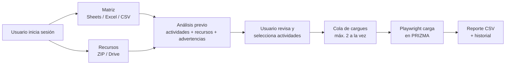

# Auto Prizma Pro — Interfaz de cargue automático

Aplicación web que automatiza el cargue de contenidos académicos en **PRIZMA**. A partir de una matriz de diseño instruccional (Google Sheets, Excel o CSV) y los recursos del curso (ZIP o carpeta de Google Drive), la aplicación entra a PRIZMA con un navegador automatizado y carga las actividades **OVI**, **OVA** y **Retos evaluativos (Challenge)**. También crea **tests evaluativos** a partir de un documento Word (.docx).

Construida con **FastAPI** y **Playwright (Chromium)**. Se despliega en **Railway** con Docker.

---

## Contenido

- [Funcionalidades](#funcionalidades)
- [Cómo funciona](#cómo-funciona)
- [Tecnologías](#tecnologías)
- [Estructura del proyecto](#estructura-del-proyecto)
- [Instalación local](#instalación-local)
- [Variables de entorno](#variables-de-entorno)
- [Configurar Google (OAuth)](#configurar-google-oauth)
- [Administración de usuarios](#administración-de-usuarios)
- [Uso: cargue de actividades](#uso-cargue-de-actividades)
- [Uso: tests evaluativos](#uso-tests-evaluativos)
- [Datos y persistencia](#datos-y-persistencia)
- [Seguridad](#seguridad)
- [Despliegue en Railway](#despliegue-en-railway)
- [Pruebas](#pruebas)
- [Notas para mantenimiento](#notas-para-mantenimiento)
- [Solución de problemas](#solución-de-problemas)

---

## Funcionalidades

- **Inicio de sesión por usuario.** Cada persona ve únicamente sus propios cargues, historial y reportes.
- **Matriz por link o por archivo.** Lee la matriz desde Google Sheets (con la cuenta de Google del usuario) o desde un archivo Excel/CSV subido.
- **Análisis previo.** Antes de cargar nada, muestra qué actividades se encontraron, qué recurso le corresponde a cada una y las advertencias (recurso faltante, diferencias entre Drive y el ZIP, duplicados).
- **Selección de actividades.** El usuario elige qué actividades cargar después de revisar el análisis.
- **Cola de cargues.** Hasta **2 cargues simultáneos**; los demás esperan en cola y se muestra su posición.
- **Seguimiento en vivo.** Página de progreso por cargue, con opción de cancelar.
- **Historial y reportes.** Cada cargue genera un reporte CSV que se puede ver en pantalla o descargar.
- **Tests evaluativos.** Lee un .docx con preguntas, lo valida, permite corregirlo en pantalla y lo crea en PRIZMA. Puede hacerse por separado (`/tests`) o junto con un cargue de actividades.
- **Tema claro/oscuro** y diseño adaptable a móvil.

---

## Cómo funciona



1. El usuario inicia sesión y, si va a usar la matriz por link, conecta su cuenta de Google.
2. Suministra la matriz y el ZIP, y marca las categorías a cargar (OVI, OVA, Retos, Test evaluativo).
3. La aplicación analiza la matriz, relaciona cada actividad con su recurso y muestra el resultado.
4. El usuario selecciona las actividades, ingresa sus credenciales de PRIZMA e inicia el cargue.
5. El cargue entra en la cola; un navegador Chromium sin interfaz entra a PRIZMA y carga cada actividad.
6. Al terminar se guarda el reporte y queda registrado en el historial.

---

## Tecnologías

| Componente | Uso |
|---|---|
| Python 3.12 | Lenguaje (imagen Docker `python:3.12-bookworm`) |
| FastAPI + Uvicorn | Servidor web y rutas |
| Playwright (Chromium) | Automatización del navegador en PRIZMA |
| openpyxl | Lectura y escritura de matrices Excel |
| python-docx | Lectura de los tests en Word |
| Google API Client + OAuth | Lectura de Google Sheets y Google Drive (solo lectura) |
| pytest | Pruebas automáticas |

---

## Estructura del proyecto

```
main.py                       Punto de entrada: arma la app (uvicorn main:app)
auto_prizma/                  Código de la aplicación
  core/
    application.py            Instancia FastAPI compartida
    config.py                 Configuración central: carpetas, variables de entorno, sesión,
                              límites de Google/Drive, cola de cargues, URL de PRIZMA y navegador
    storage.py                Lectura y escritura atómica de archivos de datos (JSON y texto)
    clock.py                  Hora de Colombia para historial, reportes y estados
  api/routes/                 Rutas web (cada módulo registra sus rutas sobre la app)
    static_files.py           Logo, estilos y script de tema
    auth.py                   Middleware de sesión, login, salir y cambio de contraseña
    google.py                 Conectar / desconectar Google
    analysis.py               Inicio y análisis previo al cargue
    uploads.py                Iniciar, seguir, cancelar y estado de cargues
    reports.py                Historial, reportes guardados y descargas
  services/                   Lógica de negocio
    auth.py                   Usuarios, contraseñas, bloqueo por intentos y cookies de sesión
    matrix_analysis.py        Lectura de la matriz (CSV/Excel/Sheets) y análisis de matriz y ZIP
    drive_zip_validation.py   Relación Drive ↔ ZIP, avisos y prevalidación rápida
    upload_jobs.py            Estado de cargues, cola de ejecución y servicios que usan las rutas
                              (crear, iniciar, cancelar y consultar trabajos)
    history.py                Historial de cargues y reportes CSV (por usuario)
  integrations/google/        Integración con Google
    oauth.py                  Conexión OAuth con Google por usuario
    drive.py                  Lectura de enlaces en Google Sheets y listado de carpetas de Drive
  automation/prizma/          Automatización de PRIZMA con Playwright
    engine.py                 Motor de cargue: lectura de la matriz y automatización de PRIZMA
    engine_overrides.py       Ajustes que se aplican sobre el motor al arrancar
    html_field.py             Formato HTML: leer el .html, escribirlo en el campo Html y quitar el archivo previo de Recurso
  domain/
    drive_resource_policy.py  Reglas para decidir qué recurso de Drive corresponde a cada actividad
    file_names.py             Nombre base y clave exacta de nombres de archivo
  web/
    views.py                  HTML de la página principal de análisis y cargue
  evaluative_tests/           Módulo de tests evaluativos (cuestionarios en PRIZMA a partir de un .docx)
    models.py                 Estructuras de datos del documento (tests, secciones, preguntas)
    parser.py                 Lectura del .docx y conversión a esas estructuras
    validation.py             Validación del documento (errores y advertencias)
    serializer.py             Exportación a JSON
    automation.py             Automatización de PRIZMA con Playwright para crear los tests
    state.py                  Estado en memoria de los trabajos y usuario de PRIZMA recordado
    views.py                  HTML del módulo (layout, revisión y tarjeta de estado)
    execution.py              Ejecución del cargue de tests en segundo plano
    routes.py                 Rutas /tests/...
scripts/
  manage_users.py             Herramienta de consola para administrar usuarios
  check_prizma_connection.py  Prueba manual de conexión con PRIZMA (navegador visible)
static/                       Archivos estáticos (logo)
.env.example                  Variables de entorno soportadas (sin valores)
tests/                      Pruebas automáticas (pytest)
uploads/ temp/ resultados/  Archivos de trabajo generados en ejecución (no se versionan)
data/                       Usuarios, tokens, historial y reportes (no se versiona; contiene secretos)
Dockerfile                  Imagen para despliegue
```

### Rutas principales

| Ruta | Descripción |
|---|---|
| `GET /login`, `POST /login` | Inicio de sesión |
| `GET /salir` | Cerrar sesión |
| `GET/POST /cambiar-clave` | Cambio de contraseña del usuario |
| `GET /` | Inicio: formulario de matriz, recursos y categorías |
| `POST /analizar` | Análisis previo de la matriz y los recursos |
| `POST /iniciar/{trabajo_id}` | Inicia (encola) el cargue con las actividades seleccionadas |
| `GET /cargue-actual` | Cargues en curso del usuario |
| `GET /proceso/{trabajo_id}` | Progreso de un cargue |
| `GET /estado/{trabajo_id}` | Estado del cargue en JSON (lo consulta la página de progreso) |
| `POST /cancelar/{trabajo_id}` | Cancela un cargue |
| `GET /historial`, `GET /reportes` | Historial de cargues y reportes generados |
| `GET /reporte/{trabajo_id}`, `GET /reporte-guardado/{registro_id}` | Ver o descargar un reporte |
| `GET /google/conectar`, `GET /google/callback`, `POST /google/desconectar` | Conexión de la cuenta de Google |
| `GET /tests` y `/tests/...` | Módulo de tests evaluativos |

---

## Instalación local

**Requisitos:** Python 3.12 o superior y Git.

```powershell
git clone https://github.com/Kevin2428/auto-prizma-pro.git
cd auto-prizma-pro

python -m venv .venv
.\.venv\Scripts\pip install -r requirements-dev.txt
.\.venv\Scripts\playwright install chromium
```

Crear el primer usuario y arrancar el servidor:

```powershell
.\.venv\Scripts\python scripts\manage_users.py crear
.\.venv\Scripts\uvicorn main:app --reload
```

Abrir http://127.0.0.1:8000 e iniciar sesión.

> En Linux/macOS los ejecutables están en `.venv/bin/` en lugar de `.venv\Scripts\`.

---

## Variables de entorno

Ninguna es obligatoria para arrancar; las de Google son necesarias solo para usar la matriz por link. La lista completa (sin valores) está en `.env.example`; la app no lee archivos `.env` automáticamente, así que hay que definirlas en el entorno (o en Railway). Todas se leen en `auto_prizma/core/config.py`.

| Variable | Descripción | Valor por defecto |
|---|---|---|
| `AUTO_PRIZMA_DATA_DIR` | Carpeta donde se guardan usuarios, tokens, historial y reportes. En producción debe apuntar a un volumen persistente. | `<proyecto>/data` |
| `AUTO_PRIZMA_SECRET` | Clave para firmar las cookies de sesión. Si no se define, se genera una y se guarda en `data/secreto_sesion.txt`. | Generada automáticamente |
| `AUTO_PRIZMA_COOKIE_SECURE` | `1` para marcar la cookie como `Secure` (solo HTTPS). También se activa sola si `GOOGLE_REDIRECT_URI` empieza por `https://`. | Desactivada |
| `AUTO_PRIZMA_MAX_SIMULTANEOS` | Cargues que pueden correr a la vez. Solo admite `1` o `2`; cualquier otro valor se toma como `2`. | `2` |
| `AUTO_PRIZMA_URL_PRIZMA` | URL de PRIZMA. Vacía = producción. Para probar sin tocar producción se usa el ambiente de pruebas `https://admin.prizma.solutions`; la pantalla muestra un aviso mientras no sea producción. | `https://admin.prizma.site` |

### Probar en el ambiente de pruebas de PRIZMA

En una terminal de PowerShell (la variable solo vale para esa terminal):

```powershell
$env:AUTO_PRIZMA_URL_PRIZMA = "https://admin.prizma.solutions"
python -m uvicorn main:app --reload
```

Al arrancar se imprime `PRIZMA: https://admin.prizma.solutions (AMBIENTE DE PRUEBAS)` y la página principal muestra el aviso. Las credenciales que se escriban son las del ambiente de pruebas. Para volver a producción basta con cerrar esa terminal (o `Remove-Item Env:AUTO_PRIZMA_URL_PRIZMA`) y reiniciar. En Railway no se define, así que allí siempre se usa producción.
| `GOOGLE_CLIENT_ID` | ID del cliente OAuth de Google. | — |
| `GOOGLE_CLIENT_SECRET` | Secreto del cliente OAuth de Google. | — |
| `GOOGLE_REDIRECT_URI` | URL de retorno de Google: `https://<dominio>/google/callback`. | — |

---

## Configurar Google (OAuth)

La matriz por link y la lectura de carpetas de Drive usan la cuenta de Google **de cada usuario**, con permisos de **solo lectura** (`spreadsheets.readonly` y `drive.readonly`).

1. En [Google Cloud Console](https://console.cloud.google.com/) crear (o elegir) un proyecto.
2. Habilitar **Google Sheets API** y **Google Drive API**.
3. Configurar la pantalla de consentimiento OAuth y agregar los permisos de solo lectura de Sheets y Drive.
4. Crear credenciales **ID de cliente de OAuth** de tipo **Aplicación web**.
5. En *URI de redireccionamiento autorizados* agregar la URL de la app terminada en `/google/callback`:
   - Producción: `https://<dominio-de-railway>/google/callback`
   - Local: `http://127.0.0.1:8000/google/callback`
6. Copiar el ID y el secreto en `GOOGLE_CLIENT_ID`, `GOOGLE_CLIENT_SECRET` y `GOOGLE_REDIRECT_URI`.

Cada usuario pulsa **Conectar con Google** dentro de la app; su token queda en `data/tokens/` y puede desconectarlo cuando quiera.

---

## Administración de usuarios

Los usuarios se gestionan desde la consola con `scripts/manage_users.py`. Todas las opciones piden los datos de forma interactiva y la contraseña no se muestra en pantalla.

```powershell
python scripts/manage_users.py listar       # Lista los usuarios y si tienen Google conectado
python scripts/manage_users.py crear        # Crea un usuario
python scripts/manage_users.py clave        # Cambia la contraseña de un usuario
python scripts/manage_users.py desactivar   # Impide el acceso sin borrar el usuario
python scripts/manage_users.py activar      # Vuelve a permitir el acceso
python scripts/manage_users.py borrar       # Elimina el usuario y su token de Google (pide confirmación; su historial se conserva)
```

La contraseña debe tener al menos 8 caracteres. Cada usuario también puede cambiar la suya desde **Mi contraseña** dentro de la app.

> En Railway estos comandos se ejecutan desde la consola del servicio, para que actúen sobre el volumen de datos de producción.

---

## Uso: cargue de actividades

### Formato de la matriz

La matriz puede tener varias hojas; cada hoja que tenga la cabecera esperada se procesa como un curso.

| Celda / columna | Contenido |
|---|---|
| `A1` | Nombre del programa |
| `A2` | Nombre del curso (si está vacío se usa el nombre de la hoja) |
| Columna `A` (fila de cabecera) | El texto **Semana correspondiente**, en alguna de las primeras 30 filas. Las actividades empiezan en la fila siguiente. |
| Columna `A` | Semana |
| Columna `B` | Unidad |
| Columna `D` | Nombre de la actividad |
| Columna `E` | Categoría: `OVI`, `OVA` o `Challenge` (reto evaluativo). Las filas con otra categoría se ignoran. |
| Columna `F` | Tipo de recurso |
| Columna `G` | Enlace al recurso (por ejemplo, el enlace de Google Drive) |

Las filas sin nombre o sin categoría se omiten.

### Pasos en la aplicación

1. **Matriz:** elegir *Por link* (pegar el enlace de Google Sheets; requiere Google conectado) o *Por archivo* (subir `.xlsx` o `.csv`; no requiere Google).
2. **Recursos:** subir el ZIP con los archivos H5P (o HTML) y PDF de las actividades.
3. **Categorías:** marcar OVI, OVA, Retos evaluativos y/o Test evaluativo, y elegir el **formato de los recursos interactivos**: *H5P* o *HTML* (ver abajo).
4. **Analizar:** revisar las actividades encontradas, el recurso asignado a cada una y las advertencias.
5. **Iniciar:** seleccionar las actividades, ingresar usuario y contraseña de PRIZMA e iniciar. Si ya hay 2 cargues en curso, el nuevo espera en cola.
6. **Seguimiento:** ver el avance en *Cargue actual*; se puede cancelar en cualquier momento.

### Formato H5P o HTML

Las actividades con recurso interactivo (OVA y OVI de tipo H5P o infografía) se pueden cargar de dos formas; los PDF no cambian:

- **H5P:** el archivo `.h5p` del ZIP se sube al campo *Recurso* de la actividad.
- **HTML:** el código completo del archivo `.html` (o `.htm`) del ZIP se pega en el campo *Html* de la actividad.
  - Cada archivo debe llamarse igual que su actividad (por ejemplo `Presupuestar Paso a Paso.html`); si dos archivos coinciden con la misma actividad, la fila no se carga.
  - El archivo debe estar en UTF-8 y ser **autocontenido**: CSS, JavaScript e imágenes incrustados o con URL absoluta (las rutas relativas no funcionan una vez pegado en PRIZMA).
  - Antes de guardar se verifica que el campo Html quedó idéntico al archivo.
  - PRIZMA no permite un archivo en *Recurso* y Html a la vez: si la actividad ya tenía **cualquier archivo** en *Recurso* (un H5P u otro; a veces PRIZMA solo lo muestra como "Archivo"), se elimina (papelera y confirmación *Eliminar*) y queda anotado en el reporte con su nombre (configurable con `PRIZMA_VACIAR_RECURSO_CON_HTML` en `auto_prizma/core/config.py`). Antes de quitar nada se comprueba que el `.html` se puede leer; si no, la actividad no se toca.
  - En formato HTML no se valida contra las carpetas de Drive de la columna G: los HTML solo vienen en el ZIP.

### Reporte

Cada cargue genera un CSV con las columnas: `Fila Excel`, `Programa`, `Curso`, `Semana`, `Unidad`, `Actividad`, `Categoría`, `Tipo`, `Recurso`, `Resultado` y `Observación`. Se consulta en **Reportes** o **Historial**.

---

## Uso: tests evaluativos

Los tests se crean en PRIZMA a partir de un documento Word. Se pueden cargar desde **Test** (`/tests`) o marcando *Test evaluativo* en el cargue de actividades. En este último caso se piden los datos académicos en el formato `CódigoPrograma CódigoPensum CódigoAsignatura NombreAsignatura`, separados por espacios o guiones, y el semestre.

### Formato del documento (.docx)

- **Título:** una línea como `Título del TEST` seguida del nombre del test.
- **Semana y corte:** por ejemplo `Semana 1 - Corte 1`.
- **Secciones:** un encabezado por tipo de pregunta:
  - `Verdadero/Falso`
  - `Selección múltiple`, `Única respuesta` u `Opción múltiple`
  - `Emparejamiento` o `Relacione`
  - `Pregunta abierta` o `Respuesta corta`
- **Preguntas** numeradas: `1. Enunciado...`
- **Respuesta correcta** al final de la pregunta o en una línea aparte:
  - Verdadero/falso: `[R: Verdadero]`, `[R: F]` o `(V)`
  - Selección: `[R: b]` o `Respuesta: b`

Ejemplo:

```text
Título del TEST
Prueba de conocimientos
Semana 1 - Corte 1
Verdadero/Falso
1. El sol es una estrella. [R: Verdadero]
Selección múltiple
2. ¿Cuánto es 2 + 2? a) 3 b) 4 c) 5 [R: b]
```

También acepta encabezados en inglés, francés y portugués (por ejemplo `True/False`, `Multiple choice`, `Matching`).

### Flujo

1. Subir el .docx o pegar el enlace de un Google Doc.
2. Revisar el resultado: la app marca en rojo las preguntas con errores (por ejemplo, sin respuesta correcta) y permite corregir títulos y enunciados en pantalla.
3. Ejecutar en PRIZMA. Si la asignatura de los datos no coincide exactamente, la app pide elegir la asignatura correcta entre las que encontró y reutiliza esa elección para los siguientes tests.
4. Seguir el avance en la página de estado. También existe un modo de **solo simulación**, que recorre el proceso sin guardar en PRIZMA.

---

## Datos y persistencia

Todo lo que debe sobrevivir a un reinicio se guarda en `AUTO_PRIZMA_DATA_DIR` (por defecto `data/`):

| Archivo / carpeta | Contenido |
|---|---|
| `usuarios.json` | Usuarios de la app con su contraseña cifrada |
| `secreto_sesion.txt` | Clave de firma de cookies (si no se usa `AUTO_PRIZMA_SECRET`) |
| `tokens/` | Tokens de Google de cada usuario |
| `historial.json` | Registro de cargues realizados |
| `reportes/` | Reportes CSV de cada cargue |

Las carpetas `uploads/` y `temp/` guardan archivos de trabajo temporales.

> **Importante:** el módulo de tests guarda el **usuario** de PRIZMA recordado (nunca la contraseña) en `<proyecto>/data/tokens/prizma_<usuario>.json`. Esta ruta es fija y no usa `AUTO_PRIZMA_DATA_DIR`.

La carpeta `data/` está en `.gitignore` y **nunca debe subirse al repositorio**.

---

## Seguridad

- **Contraseñas de la app:** se guardan con PBKDF2-SHA256 (240 000 iteraciones y sal propia por usuario); nunca en texto plano.
- **Sesión:** cookie firmada con HMAC-SHA256 que dura 12 horas. El servidor no guarda sesiones, así que reiniciar no cierra las sesiones abiertas.
- **Intentos fallidos:** tras 5 intentos fallidos el acceso se bloquea 120 segundos.
- **Aislamiento entre usuarios:** cada persona solo ve y controla sus propios cargues, reportes e historial.
- **Credenciales de PRIZMA:** se piden en cada cargue y se mantienen solo en memoria mientras dura; no se escriben en archivos.
- **Google:** cada usuario autoriza su propia cuenta, con permisos de solo lectura.

---

## Despliegue en Railway

El proyecto se despliega con el `Dockerfile` del repositorio:

- Imagen base `python:3.12-bookworm`, instala las dependencias y Chromium con `playwright install --with-deps chromium`.
- Arranca con `uvicorn main:app --host 0.0.0.0 --port 8000`.

**Despliegue automático:** cada `push` a la rama `main` dispara un nuevo despliegue en Railway.

Configuración recomendada del servicio:

1. **Volumen persistente** montado, por ejemplo, en `/app/data`, y `AUTO_PRIZMA_DATA_DIR=/app/data` para no perder usuarios, tokens ni reportes en cada despliegue.
2. **Variables de entorno:** `AUTO_PRIZMA_SECRET` (una cadena larga y aleatoria) y las de Google, con `GOOGLE_REDIRECT_URI=https://<dominio>/google/callback`.
3. **Red:** el contenedor escucha en el puerto **8000**.
4. **Volver atrás:** si un despliegue falla, en *Deployments* se puede hacer *Rollback* al anterior.

---

## Pruebas

```powershell
.\.venv\Scripts\python -m pytest -q
```

Las pruebas usan una carpeta de datos temporal (ver `tests/conftest.py`), así que no tocan los usuarios ni los reportes reales. Las pruebas de automatización simulan PRIZMA: no abren el navegador ni se conectan al sitio real.

Para probar manualmente la conexión con PRIZMA (abre un navegador visible y espera el inicio de sesión, sin modificar nada):

```powershell
.\.venv\Scripts\python scripts\check_prizma_connection.py
```

---

## Notas para mantenimiento

- **Orden de arranque (`main.py`):** primero se importa `auto_prizma.automation.prizma.engine_overrides`, que reemplaza en memoria algunas funciones del motor (`auto_prizma/automation/prizma/engine.py`) (`leer_actividades_excel`, `resolver_recurso`, `validar_carpeta_drive_para_actividad`), y luego se registran las rutas. Al modificar esas funciones hay que revisar ambos archivos.
- **Botón "Test" en Cargue actual:** lo agrega `auto_prizma/evaluative_tests/views.py` (`_patch_main_nav`) en memoria sobre `auto_prizma/api/routes/uploads.py`.
- **Equivalencias de programas:** si PRIZMA usa un nombre de programa distinto al de la matriz, se agrega explícitamente en `EQUIVALENCIAS_PROGRAMAS` (`auto_prizma/automation/prizma/engine.py`). No se usa coincidencia aproximada a propósito.
- **Límite de navegadores:** el máximo de 2 cargues simultáneos está fijado en `auto_prizma/core/config.py` para no saturar el servidor.
- **Respaldos:** no guardes copias como `main_backup_*.py`; git ya conserva cada versión (`git log -- archivo`, `git show <commit>:archivo`).

---

## Solución de problemas

| Síntoma | Causa / solución |
|---|---|
| Al conectar Google aparece *"Faltan variables de entorno de Google"* | Definir `GOOGLE_CLIENT_ID`, `GOOGLE_CLIENT_SECRET` y `GOOGLE_REDIRECT_URI`. |
| Google responde *redirect_uri_mismatch* | La URL de `GOOGLE_REDIRECT_URI` debe estar registrada exactamente igual en Google Cloud Console. |
| *"La autorizacion de Google expiro"* | El proceso de autorización dura 10 minutos; volver a pulsar **Conectar con Google**. |
| No permite iniciar sesión tras varios intentos | Bloqueo de 120 segundos después de 5 intentos fallidos; esperar e intentar de nuevo. |
| Tras un despliegue desaparecieron los usuarios o reportes | Falta el volumen persistente o `AUTO_PRIZMA_DATA_DIR` no apunta a él. |
| En el log aparece *"AVISO: existe data/google_token.json"* | Es un token compartido de una versión anterior que ya no se usa; revocarlo en https://myaccount.google.com/permissions y borrar el archivo. |
| Una hoja de la matriz no aparece en el análisis | Revisar que la columna A tenga el texto **Semana correspondiente** en alguna de las primeras 30 filas. |
